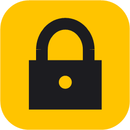

  

<h1 align="center">KidLock</h1>

  <b>Lock your keyboard and mouse, not your screen.</b> 
  Kids can keep watching cartoons, your downloads, builds and AI agents keep running —
  but nobody can click or type until you enter your password.

  <a href="https://github.com/sifadh99/kidlock/releases/latest/download/KidLock-Setup.exe"><b>⬇ Download KidLock for Windows</b></a> 
  Windows 10 (1607+) and Windows 11 · 64-bit, 32-bit and ARM64 · free

---

## Features

- **One shortcut to lock** — press `Ctrl + Shift + L`. Keyboard, mouse and touchpad stop working; everything on screen keeps running and stays visible.
- **Password to unlock** — type your password and press `Enter`. `Backspace` deletes one character, `Esc` clears everything.
- **Kid-proof** — random key mashing can't unlock it. After 3 wrong tries there is a short, growing wait (up to 10 seconds) with a countdown.
- **Safer Ctrl+Alt+Del** — while locked, *Sign out*, *Task Manager* and *Shut down* are hidden from the Ctrl+Alt+Del screen, so a kid can't close your apps by accident. They come back as soon as you unlock.
- **Screen stays awake** while locked, so the video doesn't stop when the PC would normally sleep.
- **Small lock badge** at the bottom (or top) of the screen — click-through, so it never blocks the video.
- **Settings window** — change the shortcut, password, badge position and startup behaviour.
- **No admin rights, no .NET install needed.** Password is stored as a salted PBKDF2 hash, never as plain text.

## Install

1. Download **[KidLock-Setup.exe](https://github.com/sifadh99/kidlock/releases/latest/download/KidLock-Setup.exe)**.
2. Run it. Windows may show **"Windows protected your PC"** — this appears because the app is not code-signed (signing certificates are paid). Click **More info → Run anyway**.
3. Click **Install**. KidLock starts and asks you to set an unlock password.
4. Look for the yellow lock icon in the system tray (bottom-right, maybe under `^`).

Uninstall any time from **Settings → Apps → KidLock → Uninstall**.

## How to use

| What | How |
|---|---|
| Lock | `Ctrl + Shift + L`, or tray icon → **Lock now** |
| Unlock | Type your password → `Enter` |
| Clear what you typed | `Esc` |
| Settings | Click the tray icon → **Settings…** |
| Forgot password / stuck | Hold the power button for 5 seconds to restart the PC. Nothing is changed permanently. |

## Good to know

- **`Ctrl + Alt + Del` and `Win + L` can't be blocked by any app** — that's a Windows security rule. KidLock hides the risky options on that screen instead.
- Some laptop `Fn` keys (brightness, Wi-Fi) are handled by the hardware and can't be blocked.
- Input sent by automation tools / AI agents is allowed by default so they keep working. You can turn this off in Settings.

## বাংলায় সংক্ষেপে

ছোট বাচ্চা ল্যাপটপে কার্টুন দেখতে চাইলে **KidLock** চালু করে `Ctrl + Shift + L` চাপুন — কিবোর্ড, মাউস, টাচপ্যাড লক হয়ে যাবে, কিন্তু ভিডিও চলতে থাকবে। আনলক করতে পাসওয়ার্ড লিখে `Enter` চাপুন।
ডাউনলোড: **[KidLock-Setup.exe](https://github.com/sifadh99/kidlock/releases/latest/download/KidLock-Setup.exe)** — "Windows protected your PC" দেখালে **More info → Run anyway** চাপুন।

## Credits

Idea inspired by [Clearlock](https://github.com/farhan2077/clearlock) for macOS by Farhan Bin Amin. KidLock is an independent Windows app written from scratch — no code is shared.

## License

Free to download and use. All rights reserved — see [LICENSE](LICENSE).

## Feedback

Found a bug or have an idea? [Open an issue](https://github.com/sifadh99/kidlock/issues).
